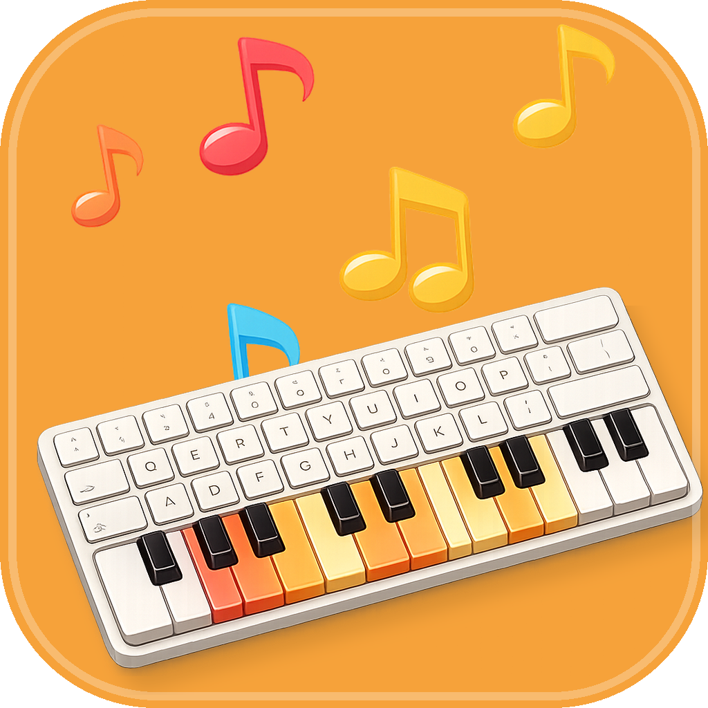
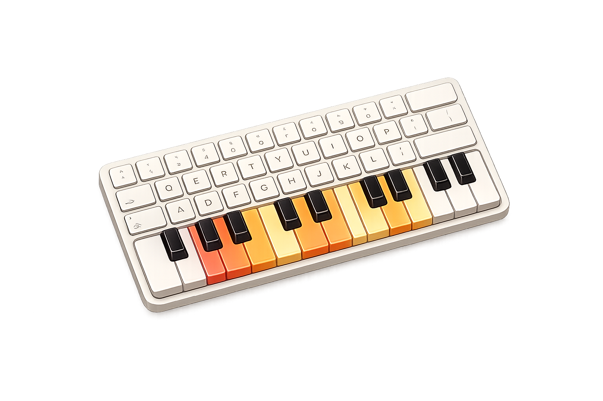
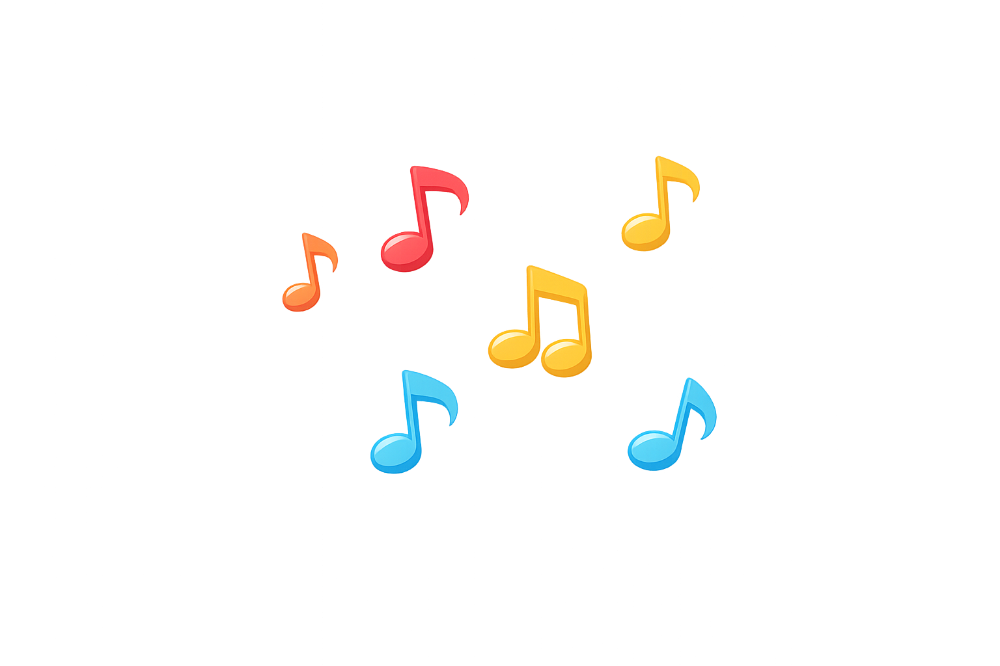
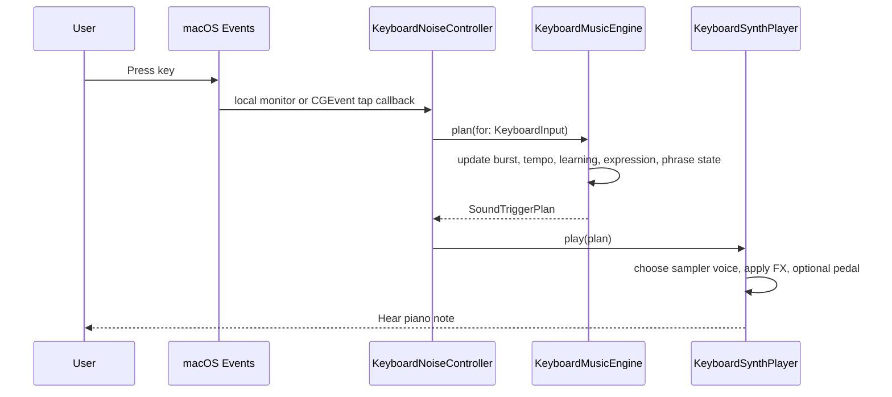

# Noisy Keys

<p align="center">
  
</p>

<p align="center">
  <strong>Turn your keyboard into piano.</strong>
</p>

<p align="center">
  
</p>

Noisy Keys turns your Mac keyboard into a piano.

It listens for keyboard input, maps each keystroke into a musical role, chooses a note that fits the current phrase, and plays that note through a sampler-backed piano voice. The app is intentionally small on the surface, but the engine under it keeps track of burst timing, adaptive letter learning, phrase motion, mood, and playback shaping so typing feels musical instead of random.

## Visuals

<p align="center">
  
</p>

<p align="center">
  A playful Mac app with a piano heart.
</p>

## What It Does

- Plays piano notes for keyboard input across macOS
- Ships with 4 curated piano sounds:
  - `Grand Room`
  - `Felt Bloom`
  - `Jazz Club`
  - `Midnight Blue`
- Includes a `Custom Mix` mode for pitch, tone, and vibe adjustments
- Learns frequently typed letters and gives them safer note families
- Uses phrase-aware piano motion instead of treating every key as a disconnected note
- Exposes a main dashboard, onboarding flow, and menu bar controller

## Product Boundaries

Current shipping assumptions:

- Language: `English`
- Platform: `macOS 13+`
- Best keyboard support: standard `US` keyboard layouts

The system-wide key translator currently falls back to a US ANSI key map when character data is unavailable. That is good for v1, but it is an explicit limitation for international keyboard layouts.

## Permissions

Noisy Keys needs `Input Monitoring` to play while you type anywhere on macOS.

Path:

`System Settings > Privacy & Security > Input Monitoring`

Enable `Noisy Keys`, then return to the app and click `Check Again`.

Without that permission, Noisy Keys can still respond inside the app window through the local `NSEvent` monitor.

## Architecture At A Glance

```mermaid
flowchart LR
    A["Keyboard Input"] --> B["KeyboardNoiseController"]
    B --> C["KeyboardInputTranslator"]
    C --> D["KeyboardMusicEngine"]
    D --> E["PianoPhraseTracker / KeyboardSoundPlanner"]
    E --> F["SoundTriggerPlan"]
    F --> G["KeyboardSynthPlayer"]
    G --> H["AVAudioUnitSampler Voice Pool"]
    H --> I["EQ + Reverb + Delay"]
    I --> J["Mac Audio Output"]
```



## Runtime Flow



## Main Pieces

### App and scenes

- `NoisyKeys/NoisyKeysApp.swift`
  Creates the shared `KeyboardNoiseController`, starts monitoring at app launch, hosts the main window, and exposes the menu bar extra.

### Product shell

- `NoisyKeys/ContentView.swift`
  Switches between onboarding and dashboard.
- `NoisyKeys/DashboardScreen.swift`
  Main app UI.
- `NoisyKeys/OnboardingView.swift`
  Onboarding shell.
- `NoisyKeys/OnboardingComponents.swift`
  Onboarding cards and step components.
- `NoisyKeys/MenuBarControlsView.swift`
  Menu bar mini-window.

### Control layer

- `NoisyKeys/KeyboardNoiseController.swift`
  Owns app state, global/local event listeners, permission guidance, selected sound mode, preview behavior, and the serialized playback queue.

### Music engine

- `NoisyKeys/KeyboardMusicEngine.swift`
  Translates input into a `SoundTriggerPlan`.
- `NoisyKeys/PianoPhraseEngine.swift`
  Adds piano-specific phrase continuity, register spread, lane motion, and cadence behavior.

### Sound engine

- `NoisyKeys/KeyboardSynthPlayer.swift`
  Plays the plan through `AVAudioEngine`, `AVAudioUnitSampler`, EQ, reverb, and delay.
- `NoisyKeys/SoundProfiles/*`
  Defines piano profiles, palettes, register maps, effect configurations, and the visible sound modes.

## Sound Modes

| Mode | Purpose | Base Character |
| --- | --- | --- |
| `Grand Room` | Open and spacious | brighter grand piano |
| `Felt Bloom` | Warm everyday default | softer felt piano |
| `Jazz Club` | Woodier and tighter | upright-style color |
| `Midnight Blue` | Darker and longer | cooler late-night tone |
| `Custom Mix` | User-shaped profile | built from pitch, tone, and vibe inputs |

## Core Engine Ideas

The app does not simply assign one fixed note to each key forever.

Instead, it combines:

- `symbol classification`
  Letters, numbers, punctuation, space, return, delete, modifiers, arrows, unknown keys
- `timing`
  Typing burst detection and cadence intensity
- `adaptive learning`
  Frequently typed letters get safer note families
- `phrase logic`
  Piano-specific lane motion keeps notes close and flowing
- `expression`
  Recent typed text, punctuation, and delete pressure influence the performance style
- `profile playback`
  Each sound mode changes palettes, register bias, durations, gain, EQ, reverb, and delay

## Deep Technical Docs

- [Architecture](docs/architecture.md)
- [Note Mapping And Sound Generation](docs/note-mapping.md)

## Build

Open the project in Xcode or build with:

```bash
xcodebuild -scheme NoisyKeys build
```

## Test

Unit tests:

```bash
xcodebuild -scheme NoisyKeys -only-testing:NoisyKeysTests test
```

UI tests exist, but macOS UI automation permissions can affect reliability on a local machine.

## Shipping Notes

Before release:

- Archive a `Release` build outside day-to-day debug runs
- Verify `Input Monitoring` onboarding on a clean machine
- Verify global typing still works when the main window is closed
- Verify menu bar reopen behavior
- Verify selected sound mode persists across relaunch
