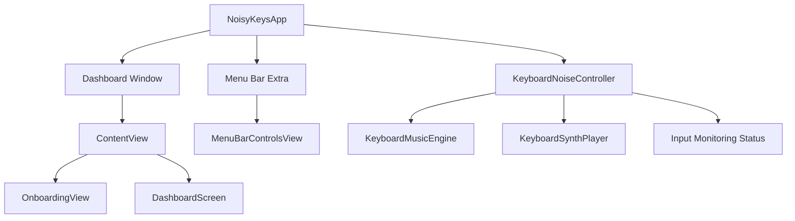
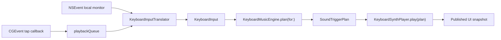
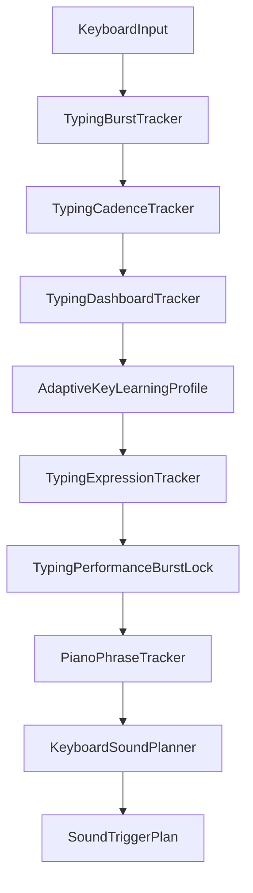
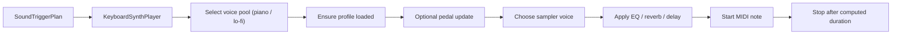
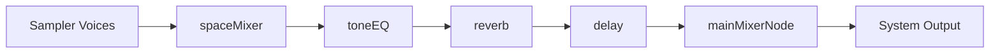

# Noisy Keys Architecture

This document explains how Noisy Keys is structured at runtime and how keyboard input moves from macOS into the music engine and out through audio playback.

## Top-Level System

## File-Level Ownership

| Area | Primary files | Responsibility |
| --- | --- | --- |
| App bootstrap | `NoisyKeysApp.swift` | Creates the shared controller, starts monitoring, defines window and menu bar scenes |
| Root view routing | `ContentView.swift` | Chooses onboarding vs dashboard |
| Onboarding | `OnboardingView.swift`, `OnboardingComponents.swift` | First-run setup flow |
| Main UI | `DashboardScreen.swift` | Primary product UI and sound selection |
| Menu bar | `MenuBarControlsView.swift` | Fast controls and reopen path |
| Controller | `KeyboardNoiseController.swift` | Event taps, queueing, selection, preview, published UI state |
| Music engine | `KeyboardMusicEngine.swift` | Timing, adaptive learning, phrase planning, mapping to `SoundTriggerPlan` |
| Piano phrase engine | `PianoPhraseEngine.swift` | Piano-specific band/lane note motion |
| Playback | `KeyboardSynthPlayer.swift` | Sampler voice pools, pedal, FX chain, note playback |
| Profiles | `SoundProfiles/*` | Sound presets and effect settings |

## App Startup

At launch:

1. `NoisyKeysApp` creates a single `KeyboardNoiseController`.
2. The controller immediately calls `start()`.
3. `start()` enables noise by default and installs the local event monitor.
4. The controller checks global access and, if permission is already granted, installs a session-level `CGEventTap`.
5. The same controller instance is shared with:
   - the dashboard window
   - the onboarding flow
   - the menu bar mini-window

That shared ownership is important: the UI is only reflecting the controller. The controller itself owns the live runtime behavior.

## Input Sources

Noisy Keys listens in two ways.

### 1. Local app monitor

When the app has focus, it can listen with:

- `NSEvent.addLocalMonitorForEvents`

That path works even when Input Monitoring is not granted.

### 2. System-wide session tap

When Input Monitoring is granted, it also installs:

- `CGEvent.tapCreate`
- tap type: `.cgSessionEventTap`
- option: `.listenOnly`

That is what makes Noisy Keys respond while you type anywhere on macOS.

## Event Pipeline

## Controller Responsibilities

`KeyboardNoiseController` is the operational center of the app.

It owns:

- `isNoiseEnabled`
- `hasGlobalAccess`
- selected sound mode
- selected profile summary strings
- dashboard stats
- custom piano settings
- the `KeyboardMusicEngine`
- the `KeyboardSynthPlayer`
- local event monitor lifecycle
- global event tap lifecycle
- serialized playback queue

### Why the playback queue matters

All sound planning and playback dispatch through a dedicated serial queue:

- mapping happens in order
- playback happens in order
- UI snapshots are derived from the same ordered plan stream

That keeps the controller from fighting the main thread during fast typing bursts.

## Permission Model

The controller exposes a simple permission story to the UI:

- `hasGlobalAccess`
- `accessMessage`
- `permissionSteps`
- `inputMonitoringPath`

When access is missing:

- the event tap is disabled
- the app still works through the local monitor when typing inside the app
- the UI shows the manual path to `Input Monitoring`

## Music Planning Pipeline

`KeyboardMusicEngine.plan(for:)` is the heart of the app.

Each new input goes through these stages:

### Stage details

#### Burst tracking

`TypingBurstTracker` resets the phrase world after 3 seconds of idle time.

When a new burst begins, the engine resets:

- cadence state
- expression state
- locked performance state
- piano phrase state
- last lead note

#### Cadence tracking

`TypingCadenceTracker` stores recent timestamps and computes:

- average interval
- notes per second
- approximate BPM
- intensity bucket:
  - `relaxed`
  - `steady`
  - `energetic`
  - `frantic`

#### Dashboard tracking

`TypingDashboardTracker` is for UI metrics, not for sound generation.

It tracks:

- rolling WPM estimate
- session-based top keys

#### Adaptive letter learning

`AdaptiveKeyLearningProfile` counts letters over time and assigns them ranks.

Those ranks feed `AdaptiveNoteFamily`, which maps frequent letters to safer note families such as:

- `Home`
- `Open`
- `Lift`
- `Warmth`
- `Color`
- `Spark`
- `Tension`

#### Expression tracking

`TypingExpressionTracker` reconstructs recent text from symbols and scores it against:

- positive lexicon
- negative lexicon
- tense lexicon
- punctuation energy
- delete pressure

That yields a `TypingTextMood`:

- `neutral`
- `joyful`
- `tense`
- `angry`

#### Burst performance lock

`TypingPerformanceBurstLock` prevents the performance style from changing every few keystrokes.

It locks a burst after a small number of meaningful events so the phrase holds one lane of expression until the burst ends.

#### Piano phrase tracking

`PianoPhraseTracker` only applies to piano playback.

It manages:

- left-to-right keyboard register spread
- active band
- melodic lane positions
- movement direction
- cadence anchoring
- continuation behavior for `Space`

#### Final planning

`KeyboardSoundPlanner` converts the chosen mapping into a concrete `SoundTriggerPlan`.

That plan includes:

- sound mode / profile snapshot
- musical role
- note label
- sound ID
- performance style
- text mood
- sustain pedal state
- velocity
- learned rank

## Playback Architecture

## Audio Graph

The audio graph is:

`KeyboardSynthPlayer` does not synthesize raw waveforms in the current version. It plays notes through `AVAudioUnitSampler` backed by Apple's system General MIDI DLS sound bank:

- sound bank:
  `/System/Library/Components/CoreAudio.component/Contents/Resources/gs_instruments.dls`

## Voice Pools

The player uses separate voice pools:

- piano voices: `40`
- lo-fi voices: `32`

Each `SamplerVoice`:

- loads the correct sampler program
- tracks its currently playing note
- reserves itself until the note tail should end
- can be reused or reloaded when the profile changes

## Effect Configuration

Each sound profile defines:

- EQ band configuration
- reverb preset and mix
- delay time / feedback / filter / wet-dry mix
- space mixer output volume
- main output volume
- sampler master gain

This is how `Grand Room`, `Felt Bloom`, `Jazz Club`, and `Midnight Blue` sound distinct without changing the controller or planner architecture.

## UI Architecture

The UI is intentionally split into two shells plus reusable components.

### Root shell

- `ContentView`
  - shows onboarding until completion
  - then shows dashboard

### Dashboard

- `DashboardScreen`
  - hero summary
  - sound picker
  - power / permission state
  - typing dashboard
  - guide or custom mix controls
  - optional debug shelf

### Onboarding

- `OnboardingView`
  - welcome
  - access
  - sound choice
  - ready

### Menu bar

- `MenuBarControlsView`
  - mirrored quick controls
  - curated sound switching
  - preview action
  - explicit reopen of the dashboard window

## Why It Feels Musical

Noisy Keys feels musical because it does not stop at a single fixed mapping table.

It layers:

- symbolic interpretation
- adaptive learning
- tempo sensing
- text-derived expression
- burst locking
- piano phrase continuity
- profile-shaped playback

That combination is what turns normal typing into something that behaves more like phrased piano performance than isolated key-click sounds.

