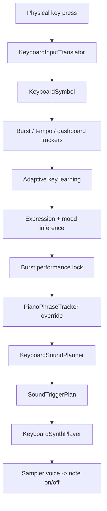
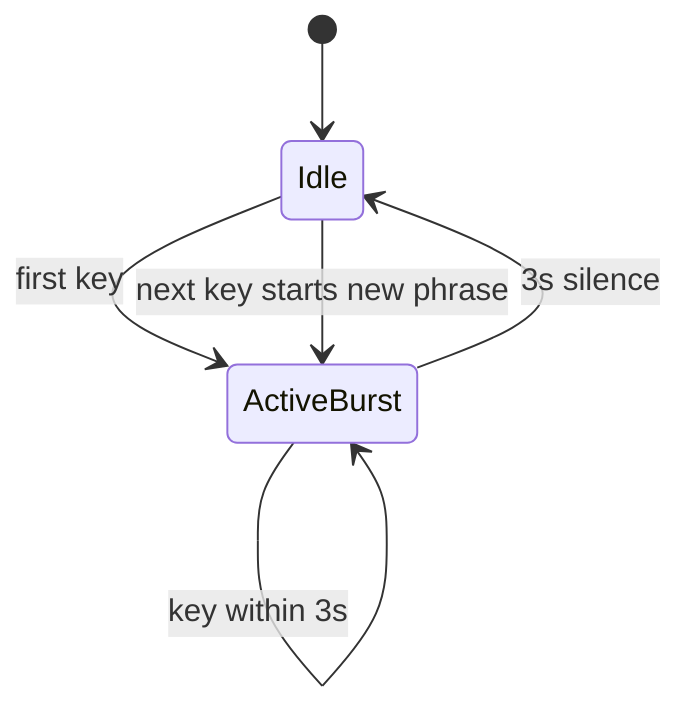
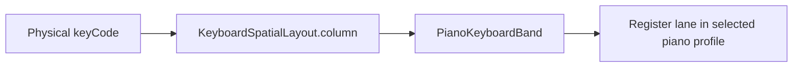
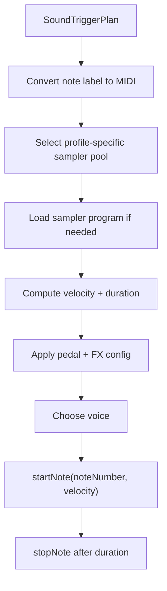
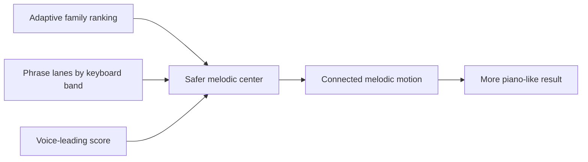

# Note Mapping And Sound Generation

This document is the deep dive into how Noisy Keys maps keystrokes into notes and how those notes become audible piano sound.

It focuses on the current shipping code, which uses:

- `KeyboardMusicEngine`
- `PianoPhraseTracker`
- `KeyboardSoundPlanner`
- `KeyboardSynthPlayer`

## The Short Version

Noisy Keys does not do this:

- `key -> one hardcoded note forever`

It does this:

- `key event -> symbol -> musical role -> candidate note family -> phrase-aware note choice -> timed playback through sampler voices`

That distinction is the reason the app can stay musical even while typing is naturally irregular.

## End-To-End Mapping Diagram

## Step 1: Translate Raw Input Into A Symbol

Raw input is translated by `KeyboardInputTranslator`.

The translator outputs a `KeyboardInput`:

- `symbol`
- `keyCode`
- `source`
- `timestamp`

### Symbol types

The symbol enum is:

- `letter(Character)`
- `number(Character)`
- `punctuation(Character)`
- `space`
- `tab`
- `returnKey`
- `delete`
- `escape`
- `modifier(KeyboardModifierKey)`
- `arrow(KeyboardArrowKey)`
- `unknown(UInt16)`

### Why this matters

The engine does not treat all keys equally.

Examples:

- letters are usually melody
- numbers are accents
- punctuation is cadence
- space is phrase pulse / continuation
- delete becomes tension
- modifiers become texture
- arrows become navigation tones

## Step 2: Detect Typing Bursts

`TypingBurstTracker` uses a `3 second` idle reset.

If the time since the previous input is at least 3 seconds:

- a new burst starts
- cadence history is reset
- expression history is reset
- performance lock is reset
- piano phrase state is reset
- previous lead note is cleared

### Why this matters

This prevents the app from dragging old phrase state forever. Each burst becomes a new musical sentence.

## Step 3: Measure Typing Tempo

`TypingCadenceTracker` keeps up to `16` recent timestamps.

From those it computes:

- average inter-key interval
- notes per second
- approximate BPM
- intensity bucket

### Intensity thresholds

| Notes per second | Intensity |
| --- | --- |
| `< 1.25` | `relaxed` |
| `< 2.8` | `steady` |
| `< 4.8` | `energetic` |
| `>= 4.8` | `frantic` |

### Why this matters

Tempo influences:

- duration multipliers
- register bias
- sustain pedal behavior
- pulse note behavior
- phrase movement behavior

## Step 4: Track Adaptive Letter Usage

`AdaptiveKeyLearningProfile` counts letters over time and ranks them by frequency.

Only letters participate in this learning layer.

Each letter can produce:

- `rank`
- `count`
- `top keys summary`

### Family assignment

Letter rank maps into `AdaptiveNoteFamily`.

Early ranks go to safer families:

| Relative rank | Family tendency |
| --- | --- |
| top letters | `Home`, `Open`, `Lift` |
| next letters | `Warmth`, `Color` |
| rarer letters | `Spark`, `Tension` |

### The actual family order

The engine uses this priority sequence before falling back to a repeating pattern:

1. `Home`
2. `Open`
3. `Lift`
4. `Warmth`
5. `Color`
6. `Home`
7. `Open`
8. `Lift`
9. `Warmth`
10. `Color`
11. `Spark`
12. `Spark`
13. `Tension`

### Why this matters

This is the main way the app avoids making common letters unpleasant.

The letters you type most often get safer note families, which gives the keyboard a more stable harmonic center over time.

## Step 5: Infer Mood From Recent Text

`TypingExpressionTracker` reconstructs recent text from symbol history.

It:

- appends letters, numbers, punctuation
- converts spaces / tabs / returns into spaces
- handles delete by removing the last rendered character
- ignores non-text symbols for text rendering

Then it scores recent words against three lexicons:

- positive
- negative
- tense

It also adds:

- punctuation energy
- delete pressure

The result is one `TypingTextMood`:

- `neutral`
- `joyful`
- `tense`
- `angry`

### Why this matters

The mood does not directly choose the exact note, but it helps choose the performance style that shapes the phrase.

## Step 6: Lock The Burst Performance

`TypingPerformanceBurstLock` prevents the vibe from switching too often.

It observes meaningful symbol events and locks a performance after:

- `4` meaningful events, or
- a burst boundary after at least `2` meaningful events

### Meaningful events

Only symbols that contribute to burst identity increase the internal count. That keeps the engine from overreacting to every space, tab, or modifier.

### Output

The lock stores:

- `textMood`
- `performanceStyle`

That state remains stable across the burst until the burst resets.

## Step 7: Choose A Performance Style

The current piano styles are:

- `mellow`
- `warm`
- `bright`
- `driving`
- `stormy`

`KeyboardPerformanceStyle.forInstrument` chooses among them from:

- instrument
- tempo intensity
- expression snapshot

### Example behavior

- joyful + relaxed -> `mellow`
- joyful + energetic -> `bright`
- neutral + relaxed -> `mellow`
- neutral + energetic -> `driving`
- angry + frantic -> `stormy`

### Why this matters

Performance style influences:

- note family candidate expansion
- register preference
- duration bias
- velocity scale
- sustain pedal behavior
- pulse motion

## Step 8: Piano Phrase Tracking

This is the most important layer for making typing sound like piano instead of random isolated notes.

`PianoPhraseTracker` only applies when the instrument is piano.

If the instrument is not piano, the generic planner decides the mapping alone.

## Spatial Register Model

Noisy Keys maps physical key position into a rough keyboard column using `KeyboardSpatialLayout`.

That column is converted into one of five bands:

- `bass`
- `low`
- `middle`
- `upper`
- `high`

### Why this matters

This spreads the typing keyboard across piano range instead of collapsing everything into one narrow register.

Left-side keys lean lower, right-side keys lean higher.

## Per-Band Melodic Lanes

Each piano profile provides a `PianoRegisterMap`:

- `bass`
- `low`
- `middle`
- `upper`
- `high`

Each band has:

- a current lane index
- a current direction
- an event count

That lets the app move through nearby notes instead of leaping wildly.

## Letter Mapping In Piano Mode

For letters:

1. determine the current band from keyboard position
2. determine the adaptive note family from learned rank
3. ask `nextMelodyNote(in:band:family:tempo:)`
4. move within that band's melodic lane according to phrase rules

### Movement behavior

The requested movement depends on:

- note family
- tempo intensity
- event count in the band
- current travel direction

#### Family tendencies

| Family | Typical movement |
| --- | --- |
| `Home` | hold position |
| `Open` | follow current direction |
| `Lift` | drift upward |
| `Warmth` | lean downward or settle |
| `Color` | move with direction |
| `Spark` | move upward |
| `Tension` | upward unless stormy, then downward |

#### Tempo gate

The faster you type, the more frequently movement is allowed:

| Intensity | Gate |
| --- | --- |
| `relaxed` | every 3 events |
| `steady` | every 2 events |
| `energetic` / `frantic` | every event |

This is how the same layout can feel calm when typing slowly and more active when typing quickly.

## Non-Letter Mapping In Piano Mode

### Numbers

- role: `accent`
- behavior: ornament note in the current band

### Punctuation

- role: `cadence`
- behavior: pull toward a cadence anchor in the current lane

### Space

- role: `pulse`
- behavior: continuation note
- effect: helps keep the phrase connected instead of injecting an unrelated note

### Return

- role: `cadence`
- behavior: phrase resolving note

### Delete / Escape

- role: `tension`
- behavior: step away from the current note

### Tab / Modifiers

- role: `texture`
- behavior: decorative nearby note

### Arrows

- role: `navigation`
- behavior:
  - left/right shift the active band
  - up/down ornament within the active band

## Generic Planner Behavior

If there is no phrase override, or if the instrument is not piano, `KeyboardSoundPlanner` falls back to the generic mapping logic.

The generic planner still uses:

- symbol type
- adaptive family
- tempo
- performance style
- previous lead note
- profile palettes

## Role Mapping Summary

| Symbol type | Musical role |
| --- | --- |
| letter | melody |
| number | accent |
| punctuation | cadence |
| space | pulse |
| return | cadence |
| delete / escape | tension |
| tab / modifier | texture |
| arrow | navigation |
| unknown | accent |

## Candidate Note Selection

For adaptive melodic selection, the engine builds a candidate set from the note family.

For piano, that family is expanded by performance style.

Example:

- `Home` starts from a base such as `C4 E4 G4 C5`
- `Bright` may inject higher extras like `E5 G5`
- `Mellow` may duplicate more stable midrange notes

Then the planner scores candidates using:

- distance from an anchor MIDI note
- distance from the previous lead note
- repeat penalty
- register bias

### Anchor MIDI

The anchor MIDI comes from:

- profile anchor base
- tempo intensity offset
- performance style register offset
- keyboard spatial column
- profile register bias

That is how the physical keyboard position and current expressive state shape the preferred register.

## Voice Leading

The planner tries to minimize awkward jumps.

It computes a score for each candidate note:

- closeness to previous note
- closeness to desired anchor register
- repeated-note penalty
- register preference bias

The note with the lowest score wins.

This is why the app usually moves by small steps or near-neighbor motion instead of teleporting around the scale.

## Pulse Note Logic

`Space` is handled specially.

The engine uses `dynamicPulseNote(...)` to choose a support note relative to the previous lead note.

Examples:

- `mellow` tends to stay or drift downward
- `warm` tends to choose the nearest support note
- `bright` tends to drift upward
- `driving` pushes upward without allowing same-pitch fallback as easily
- `stormy` tends to pull down harder

That is one of the key reasons spaces feel like phrase support instead of random interruption.

## Sustain Pedal Logic

The `SoundTriggerPlan` includes `sustainPedalEngaged`.

For piano only, sustain is chosen from:

- symbol type
- tempo intensity
- performance style

### General rules

- delete, escape, return, punctuation: no sustain
- modifiers and arrows: no sustain
- mellow letters: sustain more often
- warm letters: sustain unless typing is frantic
- bright letters: sustain only in narrower cases
- driving / stormy: generally avoid sustain

This keeps mellow passages more connected and intense passages cleaner.

## Final Plan Object

The engine returns a `SoundTriggerPlan`.

Fields include:

- `instrument`
- `profile`
- `role`
- `soundID`
- `noteLabel`
- `noteFamilyName`
- `keyLabel`
- `source`
- `tempo`
- `textMood`
- `performanceStyle`
- `sustainPedalEngaged`
- `velocity`
- `learnedRank`

### Sound ID format

The planner generates stable IDs in this shape:

`{profile.soundPrefix}.{role}.{keyAssetKey}.{normalizedNote}`

Example shape:

`felt-bloom.melody.e.c4`

That makes it possible to reason about mapping identity independently of playback implementation.

## How The Note Becomes Sound

The current version of Noisy Keys does not synthesize notes from raw oscillators.

It uses:

- `AVAudioEngine`
- `AVAudioUnitSampler`
- Apple's system DLS sound bank

## Playback Diagram

## MIDI Conversion

`KeyboardNoteFrequency` parses note labels like:

- `C4`
- `D#5`
- `Bb3`

Then it converts them to MIDI note numbers.

Formula:

- split note name from octave
- map note name to semitone
- compute MIDI with:
  - `((octave + 1) * 12) + semitone`

It can also convert to frequency in Hz:

- `440 * 2^((midi - 69) / 12)`

The playback layer uses the MIDI value directly.

## Voice Pools

The player keeps preloaded sampler voice pools:

- `40` piano voices
- `32` lo-fi voices

Each `SamplerVoice` owns:

- one `AVAudioUnitSampler`
- currently playing note tracking
- reservation end time

### Why this matters

Without pooled voices, rapid typing would constantly cut off notes or require expensive reconfiguration.

## Sampler Program Loading

Each profile specifies:

- `programNumber`
- `masterGain`

On load, each sampler voice calls:

- `loadSoundBankInstrument(...)`

using the built-in system DLS bank.

That means the audible piano timbre comes from:

- the chosen GM instrument program
- profile effect shaping
- timing / pedal / duration behavior

## Duration Calculation

Durations come from `InstrumentPlaybackProfile`.

For piano, that delegates to `PianoPlaybackProfile`.

Duration depends on:

- note role
- tempo intensity
- performance style
- profile duration scales
- continuity bias from average interval

### Piano role bases

The code starts from base durations such as:

- melody: `0.82`
- pulse: `0.24`
- cadence: `1.08`
- tension: `0.50`
- texture: `0.44`
- accent: `0.60`
- navigation: `0.46`

Those are then scaled further.

## Velocity Calculation

The planner starts from a normalized mapping velocity, then multiplies it by a style scale.

Rough tendency:

- `mellow` softer
- `warm` slightly softer
- `bright` neutral
- `driving` stronger
- `stormy` strongest

Then the playback layer converts the final value into MIDI velocity `1...127`.

## FX Chain

The player routes sound through:

1. `spaceMixer`
2. `toneEQ`
3. `reverb`
4. `delay`
5. `mainMixerNode`

Each profile defines:

- EQ bands
- reverb preset
- reverb mix
- delay time
- delay feedback
- delay low-pass cutoff
- delay mix
- space mixer volume
- output volume

This is the main reason the four presets feel distinct while sharing the same planner architecture.

## Why The Notes Feel Less Random Than Typing

The engine layers multiple stabilizers:

More concretely:

- common letters get safer families
- physical keyboard position shapes register
- phrases stay within melodic lanes
- spaces continue rather than interrupt
- cadence symbols resolve
- velocity and duration react to playing style
- sustain is applied selectively

## Important Current Limitation

System-wide translation currently falls back to a US ANSI key map when character information is unavailable from the global event path.

That means:

- the musical system is strongest for standard US keyboard layouts
- international layout support is a future expansion area

## Mental Model To Keep In Mind

If you need to understand Noisy Keys quickly, use this sentence:

> The app treats typing as phrase-aware piano performance, not as a flat per-key soundboard.

That is the guiding idea behind the mapping system, the adaptive learning model, the piano phrase engine, and the sampler playback layer.

